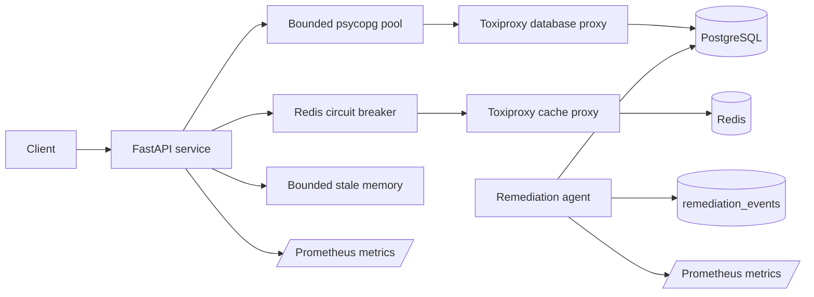

# Cloud Reliability Lab

A reproducible PostgreSQL, caching, failure-injection, and bounded-remediation lab. It turns
reliability claims into inspectable experiments: measure a query plan, change one design variable,
inject dependency failures, observe degraded behavior, and verify recovery.

This repository is a local engineering lab. It is not evidence of production performance,
availability, self-healing, or an AWS deployment.

## What it demonstrates

- PostgreSQL 17 query profiling with `EXPLAIN (ANALYZE, BUFFERS, FORMAT JSON)`
- deterministic data generation and a baseline-to-index benchmark
- bounded psycopg connection pools and per-query timeouts
- Redis read-through caching with a closed/open/half-open circuit breaker
- database fallback and bounded in-memory stale responses
- liveness, dependency-aware readiness, structured logs, and Prometheus metrics
- Toxiproxy database/cache outages and latency injection
- narrowly scoped idle-transaction remediation with an audit trail
- custom-format backup and isolated restore verification
- an explicit AWS production mapping and its unresolved controls

## Architecture



PostgreSQL is authoritative. Redis is an optimization. The process-local stale cache is only used
when PostgreSQL is unavailable, is time-bounded, and is identified in both the response body and a
`Warning` header.

## Quick start

Requirements: Docker with Compose v2 and `curl`.

```bash
cp .env.example .env
docker compose up -d --build --wait
curl --fail http://localhost:8003/health
curl --fail http://localhost:8003/ready
curl --fail http://localhost:8003/api/tenants/42/orders/summary
curl --fail http://localhost:8003/metrics
```

The development password and published ports are intentionally local-only defaults.

## Reproducible query experiment

```bash
docker compose run --rm tools -m app.benchmark \
  --rows 250000 \
  --iterations 7 \
  --warmups 2 \
  --output /tmp/query-index-benchmark.json
```

The experiment drops the candidate index, loads deterministic rows, records warm and measured
baseline plans, creates:

```sql
CREATE INDEX orders_tenant_status_created_idx
ON orders (tenant_id, status, created_at)
INCLUDE (total_cents);
```

It then records the indexed plans and refuses to produce a report if the aggregate result changes.
A local Docker run on PostgreSQL 17.5 measured:

| Phase | Median execution | Plan leaf | Shared hit blocks |
| --- | ---: | --- | ---: |
| Baseline | 6.599 ms | sequential scan | 8,336 |
| Indexed | 0.042 ms | index-only scan | 10 |

That run used 250,000 generated rows, seven measured samples, and two warmups. The observed
157.1-times median ratio is environment- and data-specific; it is not a production forecast or
service-level claim.

## Failure experiments

Populate both the external and stale caches:

```bash
curl --fail http://localhost:8003/api/tenants/42/orders/summary
curl --fail http://localhost:8003/api/tenants/42/orders/summary
```

Disable Redis; the request is served from PostgreSQL:

```bash
docker compose run --rm tools -m app.network_faults cache down
curl --fail http://localhost:8003/api/tenants/42/orders/summary
```

Disable PostgreSQL as well; tenant 42 is served from bounded stale memory, while an uncached tenant
returns `503`:

```bash
docker compose run --rm tools -m app.network_faults database down
curl --fail http://localhost:8003/api/tenants/42/orders/summary
curl --include http://localhost:8003/api/tenants/43/orders/summary
curl --include http://localhost:8003/ready
```

Restore dependencies:

```bash
docker compose run --rm tools -m app.network_faults database up
docker compose run --rm tools -m app.network_faults cache up
```

Latency can be added and removed without stopping the containers:

```bash
docker compose run --rm tools -m app.network_faults database latency \
  --latency-ms 500 --jitter-ms 50
docker compose run --rm tools -m app.network_faults database clear-latency
```

## Scoped remediation

Only idle transactions whose PostgreSQL `application_name` starts with
`reliability-lab-fault-` are eligible. Age, database, backend type, and a per-cycle maximum are
checked before termination.

```bash
docker compose run --rm tools -m app.faults idle-transaction --seconds 120
docker compose exec db psql -U reliability -d reliability \
  -c "SELECT occurred_at, action, outcome, details FROM remediation_events ORDER BY id DESC LIMIT 5"
```

The agent deliberately cannot terminate arbitrary user sessions. Production remediation should
normally favor managed limits, traffic shedding, cancellation, and escalation over backend
termination.

## Backup and restore verification

```bash
./scripts/backup.sh
./scripts/restore_verify.sh
```

The restore script creates an isolated database, restores the custom-format dump, compares source
and restored order counts, and removes the temporary database. This proves restore mechanics and a
basic invariant, not recovery point or recovery time objectives.

## Development checks

```bash
python -m pip install -e ".[dev]"
ruff check app tests
mypy app tests
pytest --cov=app --cov-report=term-missing --cov-fail-under=80
docker compose config --quiet
docker build .
```

## Documentation

- [Architecture](docs/ARCHITECTURE.md)
- [Experiment catalog](docs/EXPERIMENTS.md)
- [Failure model](docs/FAILURE_MODEL.md)
- [Operations runbook](docs/OPERATIONS.md)
- [AWS deployment mapping](docs/AWS_DEPLOYMENT.md)
- [Portfolio evidence](docs/PORTFOLIO_EVIDENCE.md)
- [Principal Engineer review](docs/PRINCIPAL_ENGINEER_REVIEW.md)
- [Roadmap](docs/ROADMAP.md)
- [Architecture decisions](docs/adr/)

## License

[MIT](LICENSE)
