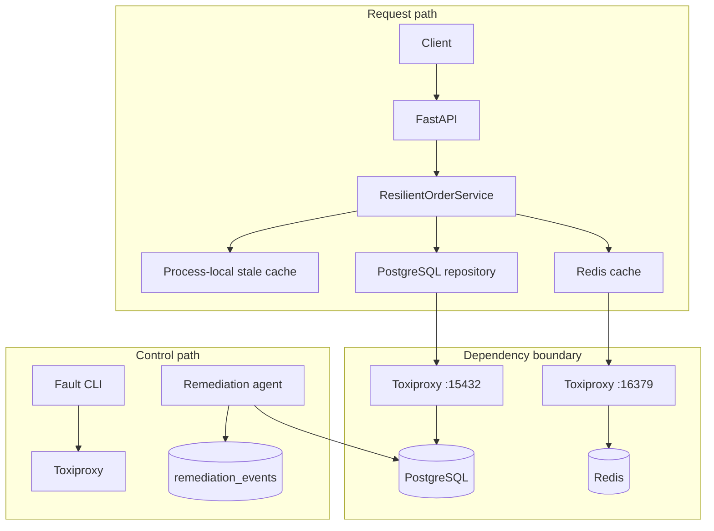

# Architecture

## System boundary

The lab exposes one read-only order-summary API backed by PostgreSQL and Redis. Toxiproxy sits
between the API and both dependencies so network conditions can be changed without modifying the
application. A separate agent inspects PostgreSQL for deliberately tagged idle transactions.

## Request algorithm

1. Attempt the Redis read unless the circuit is open.
2. Return a cache hit immediately.
3. Query PostgreSQL through the bounded pool.
4. On success, update process-local stale memory and attempt a Redis write.
5. On PostgreSQL failure, return a non-expired stale value if one exists.
6. Otherwise return a generic `503`.

Each successful response names its `cache`, `database`, or `stale` source. A stale result also
includes an RFC-style `Warning` response header.

## Data ownership

PostgreSQL is authoritative. Redis may be flushed or unavailable without losing source data. The
process-local cache is not shared across replicas and disappears on restart. Its purpose is to make
the stale-if-error trade-off visible, not to serve as a durable cache.

`orders` contains generated lab data. `remediation_events` is an append-only audit record for
remediation attempts. Neither table represents a production schema or retention policy.

## Connection-pool boundary

The API owns one psycopg `ConnectionPool`:

- minimum and maximum sizes are configured independently;
- checkout has a finite timeout;
- each connection receives a finite PostgreSQL `statement_timeout`;
- pool occupancy is exported as Prometheus gauges;
- application shutdown closes the pool.

The pool maximum is a per-process limit. A deployment must calculate total possible connections as
replicas multiplied by workers multiplied by each process's pool maximum, then reserve headroom for
migrations, monitoring, administration, and failover.

## Cache circuit

The Redis adapter uses a lock-protected circuit breaker:

- `closed`: calls flow and consecutive failures are counted;
- `open`: calls fail fast during the recovery window;
- `half_open`: one probe is allowed;
- successful probe: close and reset the failure count;
- failed probe: reopen and restart the recovery window.

The breaker limits repeated Redis waits; it does not prove that PostgreSQL has enough capacity to
absorb all cache-miss traffic.

## Health semantics

`/health` is process liveness and does not call dependencies.

`/ready` reports:

| PostgreSQL | Redis | HTTP | State |
| --- | --- | ---: | --- |
| healthy | healthy | 200 | ready |
| healthy | unavailable | 200 | degraded |
| unavailable | any | 503 | unavailable |

The readiness choice accepts uncached database reads during a Redis outage. Production rollouts
should revisit this policy against database capacity and traffic patterns.

## Remediation boundary

The remediation agent connects directly to PostgreSQL rather than through the fault proxy. A
candidate must satisfy all of these conditions:

- state is `idle in transaction`;
- backend type is `client backend`;
- database is the current database;
- age exceeds the configured threshold;
- `application_name` starts with `reliability-lab-fault-`;
- the cycle's termination maximum has not been reached.

The controller repeats the prefix check before termination and records the outcome. The double
check narrows accidental scope but does not turn termination into a generally safe production
policy.

## Observability

The API exports request counts and latency, dependency availability, circuit transitions, and pool
statistics. The remediation agent exports inspected and terminated counts. Labels are deliberately
bounded and exclude tenant identifiers, connection strings, SQL text, and exception messages.

Structured logs record lifecycle, remediation totals, and sanitized dependency failures. Logs are
stdout-only; production requires collection, retention, access control, and correlation standards.

## Trust and security boundaries

- HTTP clients cannot provide database or cache addresses.
- configuration is environment-based and validated at startup;
- dependency exceptions are translated into generic domain errors;
- database statements use parameters;
- containers run as a non-root user;
- development ports and credentials are not production defaults;
- the Toxiproxy control API is a privileged test interface and must not be exposed in production.
