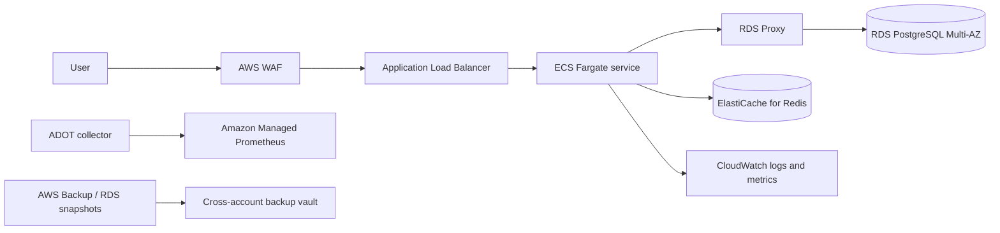

# AWS Deployment Mapping

No AWS environment is provisioned by this repository. This document maps the local boundaries to a
credible production design and calls out the controls that still require implementation and
validation.

## Proposed topology

Use private subnets for ECS tasks, RDS Proxy, RDS, and ElastiCache. Only the load balancer is
internet-facing. VPC endpoints should cover Secrets Manager, CloudWatch, ECR, and object storage
where practical so runtime traffic does not depend on public egress.

## Local-to-AWS mapping

| Lab component | AWS candidate | Required production work |
| --- | --- | --- |
| FastAPI container | ECS Fargate service | autoscaling evidence, deployment alarms, graceful drain |
| psycopg pool | per-task pool behind RDS Proxy | fleet-wide connection budget and failover tests |
| PostgreSQL | RDS PostgreSQL Multi-AZ | encryption, parameter groups, maintenance and PITR |
| Redis | ElastiCache replication group | TLS/auth, cluster topology, eviction and failover policy |
| stdout logs | CloudWatch Logs | retention, redaction, access, correlation and export |
| Prometheus endpoint | ADOT to Amazon Managed Prometheus | scrape auth, cardinality and alert ownership |
| local dump | automated RDS snapshots/AWS Backup | vault lock, cross-account copy, restore drills |
| Toxiproxy | pre-production fault environment only | isolated control plane and approved experiments |
| remediation agent | EventBridge/ECS task or operational automation | dry run, IAM, approvals, audit and rollback |

## Identity and secrets

- give each ECS task a dedicated IAM task role;
- store database and Redis credentials in Secrets Manager;
- inject secret references rather than values in task definitions;
- rotate credentials and verify connection refresh behavior;
- separate application, migration, monitoring, and remediation database roles;
- do not grant the API `pg_signal_backend`;
- if termination remains approved, grant the remediation identity only the minimum database
  capability and scope it through stronger ownership metadata than `application_name`.

## Database capacity

Calculate:

\[
\text{maximum application connections}
= \text{tasks} \times \text{workers per task} \times \text{pool maximum}
\]

Add migration, monitoring, administration, and failover reserves. Validate the result against RDS
instance capacity and RDS Proxy behavior. RDS Proxy can smooth connection churn but does not remove
transaction, query, lock, or database CPU limits.

The covering index must be assessed against production selectivity and write cost. Use a concurrent
index migration where supported, monitor replication lag and storage, and define rollback.

## Availability and scaling

- run tasks across at least two availability zones;
- configure target tracking on request load and resource saturation;
- protect PostgreSQL with request concurrency limits and load shedding during cache outages;
- configure ALB health checks against readiness only after confirming degraded-cache policy;
- use deployment circuit breakers and alarms for failed rollouts;
- test PostgreSQL failover, Redis primary promotion, task replacement, and availability-zone loss.

## Observability

Minimum signals:

- request rate, error rate, latency, and saturation;
- response source distribution (`cache`, `database`, `stale`);
- stale-response count and age;
- pool used, waiting, and maximum connections;
- database connections, CPU, storage, locks, query latency, and replication lag;
- Redis latency, errors, evictions, memory, and failovers;
- circuit transitions;
- remediation inspected, attempted, rejected, and terminated counts;
- backup age and restore-test result.

Keep tenant identifiers and SQL text out of high-cardinality metric labels. Route alarms to an
owned escalation policy with links to the runbook.

## Recovery objectives

RPO and RTO must be business decisions, not values inferred from a successful local restore.
Configure point-in-time recovery, snapshot retention, cross-account copies, and deletion
protection. Exercise restoration into an isolated account or VPC, run schema and application
checks, measure elapsed time, and retain evidence.

## Infrastructure as code

A production implementation should add Terraform or AWS CDK modules for networking, ECS, RDS
Proxy/RDS, ElastiCache, IAM, secrets, telemetry, alarms, and backup policy. CI should run formatting,
validation, policy checks, plan review, and drift detection. This lab intentionally stops at the
architecture mapping so it does not claim an unexecuted AWS deployment.
